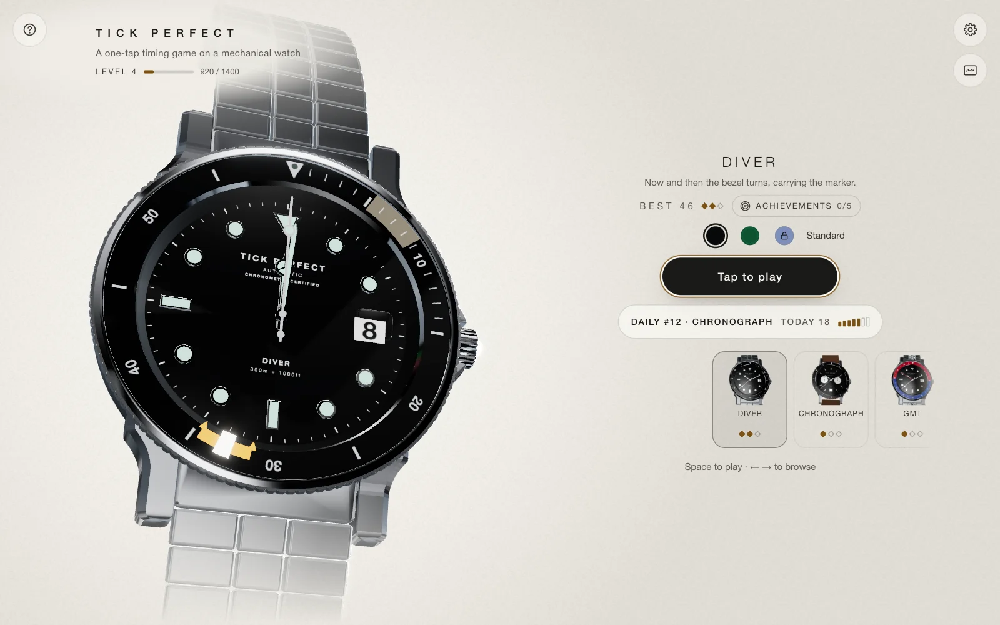

# Tick Perfect

[](https://github.com/mylcin/tick-perfect/actions/workflows/ci.yml)
[](LICENSE)

A one-tap timing game played on a 3D mechanical watch.

**[Play in the browser →](https://tick-perfect.vercel.app)**



Tap the moment the seconds hand reaches the marker. Each hit reverses the
hand, speeds it up and narrows the window; one miss ends the run.

## Highlights

- **Watches built in code.** Each one modelled procedurally from a data
  spec and bringing one rule taken from a real complication: a turning dive
  bezel, a chronograph's start and stop, a GMT hand in the way, a
  moonphase's hidden marker, a rocking tourbillon and Endless mixing them
  all. Level up and more watches open, each left for you to find.
- **A reason to come back.** A daily round shared by every player, ghosts
  of your best rounds to race, practice sets, a watchmaker's level that
  opens the collection, certificates and colourways earned by play, and
  achievements engraved on the caseback. No ads, purchases or required
  accounts.
- **Sound without samples.** The movement's tick and the repeater's gongs
  are synthesised as the game runs.
- **Plays anywhere.** Touch or keyboard, installable, offline after the first
  visit, in English and Turkish.
- **Optional online play.** Leaderboards whose scores the server replays and
  verifies before they count.

## Tech stack

TypeScript, React 19, Three.js with React Three Fiber, Zustand, Tailwind CSS
and Vite. Vitest and Playwright for testing; Supabase and Vercel Functions
for the optional online side.

## Getting started

Requires Node.js 22.

```bash
npm install
npm run dev
```

The game runs fully offline with no configuration. `npm run check` runs
linting, type checking, the unit tests and the production build.

## Documentation

- [Development guide](docs/DEVELOPMENT.md): architecture, testing and
  deployment
- [Online services](docs/BACKEND.md): leaderboards, sign-in and the admin
  panel
- [Contributing](CONTRIBUTING.md) · [Changelog](CHANGELOG.md)

## License

Released under the [MIT License](LICENSE). Studio lighting:
[Studio Small 03](https://polyhaven.com/a/studio_small_03) by Greg Zaal,
Poly Haven (CC0).
